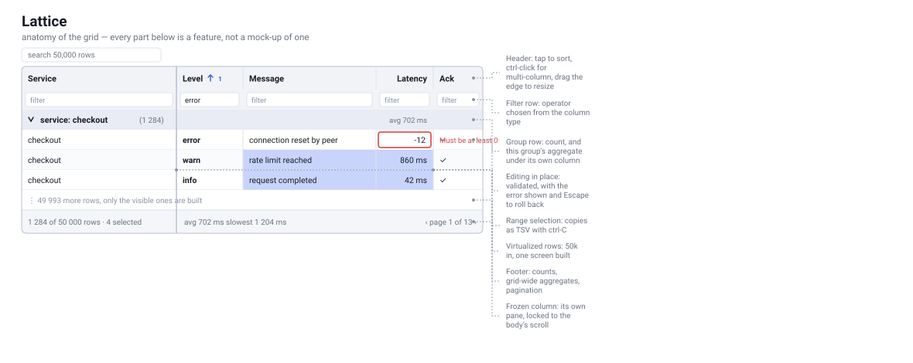

<h1 align="center">Lattice</h1>

<p align="center">
  <em>A data grid that does the hard parts — frozen columns, grouping with
  subtotals, range selection, inline editing, tens of thousands of rows —<br/>
  and asks you for nothing. No licence key, no paid tier, no evaluation
  banner.</em>
</p>

<p align="center">
  <a href="https://github.com/Dhairya-007/lattice/actions/workflows/ci.yml">
    
  </a>
  <a href="LICENSE"></a>
  
  
</p>

---

<p align="center">
  <picture>
    <source media="(prefers-color-scheme: dark)" srcset="docs/anatomy-dark.svg"/>
    
  </picture>
</p>

<p align="center">
  <sub>Every part labelled above is a feature, not a mock-up of one. This is a
  diagram rather than a screenshot — for the running app, see
  <a href="#the-demo-app">the demo app</a>.</sub>
</p>

Every serious data grid for Flutter is either commercial or a styled
`DataTable` that falls over at ten thousand rows. Lattice is the third option:
the feature set you would pay for, under MIT, with the engine deliberately
kept separate so it can grow past Flutter.

```dart
LatticeDataGrid<Employee>(
  controller: GridController<Employee>(
    columns: [
      GridColumn(field: 'name', value: (e) => e.name, pin: ColumnPin.start),
      GridColumn(
        field: 'salary',
        type: ColumnType.number,
        value: (e) => e.salary,
        setValue: (e, v) => e.copyWith(salary: v! as num),
        validator: numberRange(min: 0),
      ),
      GridColumn(field: 'department', value: (e) => e.department),
    ],
    dataSource: InMemoryDataSource(employees),
    aggregations: const [Aggregation.sum('salary')],
  ),
  showFilterRow: true,
)
```

## What you get

| | |
| --- | --- |
| **Sorting** | multi-column, stable, custom comparators, explicit null placement |
| **Filtering** | 16 operators, a serialisable condition tree, free-text search, a filter row |
| **Grouping** | nested levels, derived keys, per-group aggregates, collapsible headers |
| **Aggregates** | sum, average, min, max, count, distinct count, custom reducers |
| **Frozen columns** | leading and trailing panes, locked to the body's scroll |
| **Virtualization** | uniform and variable row heights, plus column windowing for wide grids |
| **Selection** | rows, cells, rectangular ranges, full keyboard navigation, TSV copy |
| **Editing** | validated sessions, inline errors, commit or roll back |
| **Paging** | local or server-driven, with a summary footer |
| **Export** | RFC 4180 CSV, grouped CSV, clipboard text |
| **Theming** | follows the Material theme, light and dark, fully overridable |

## The architecture, and why it is like that

```
packages/
  lattice_core/      pure Dart. No Flutter. The entire engine.
  lattice_flutter/   widgets. Renders the engine, forwards gestures.
```

Grid behaviour is where grids actually go wrong, and almost none of it is
about painting: a sort that is not stable, a filter row that blanks the grid
while it is half-typed, an expansion state that resets when the data reloads,
a slow response from an old query overwriting a newer one.

In Lattice all of that is plain Dart in `lattice_core`, so it is covered by
fast unit tests rather than widget tests that need a pumped frame to assert
anything. The Flutter package is a thin shell: read `controller.visibleRows`,
draw it, turn taps into controller calls.

That split is also the plan for the web. An Angular or React adapter is a
rendering layer over the same engine rather than a second implementation of
every rule — which is the only way two front ends ever stay consistent.

## Data sources

One `GridQuery` carries everything the view implies — sorts, filters, search,
grouping, aggregates, offset, limit — so the grid does not care where rows
come from:

```dart
// Local: the whole pipeline runs in memory.
InMemoryDataSource(rows)

// Remote: translate the query, return the page.
AsyncDataSource((query) async {
  final page = await api.employees(
    sort: query.sorts.map((s) => '${s.field}:${s.direction.name}').join(','),
    filter: jsonEncode(query.filter?.toJson()),
    offset: query.offset,
    limit: query.limit,
  );
  return GridResult(rows: page.rows, totalCount: page.total);
})
```

Concurrent fetches are token-guarded, so a stale response can never overwrite
a newer one.

## Getting started

```yaml
dependencies:
  lattice_flutter: ^0.1.0
```

### The demo app

20,000 generated log lines behind the grid, with grouping, pagination, a
filter row, custom cell widgets, a severity-aware comparator and editable
cells:

```bash
cd packages/lattice_flutter/example && flutter run
```

<!-- Drop a recording at docs/demo.gif and it appears here. docs/demo.md has
     the capture commands and a shot list. -->

### The engine, with no Flutter at all

The whole pipeline runs from the command line, which is also how it is
smoke-tested on machines without the Flutter SDK:

```
$ dart run example/lattice_core_example.dart

-- sorted by salary, highest first
Gita        Engineering $156k       2018
Asha        Engineering $142k       2021
Bruno       Engineering $128k       2022
Farah       Sales       $115k       2024
Dalia       Design      $104k       2023
Chen        Design      $96k        2020
Emre        Sales       $88k        2019

-- grouped by department, with aggregates
Design (2)
  Dalia       Design      $104k       2023
  Chen        Design      $96k        2020
Engineering (3)
  Gita        Engineering $156k       2018
  ...
payroll total: 829000
```

### Speed

`dart run benchmark/grid_benchmark.dart`, median of 7 runs, milliseconds:

| operation | 10k rows | 50k rows |
| --- | --- | --- |
| first load | 0.05 | 0.39 |
| sort by one column | 4.4 | 28.2 |
| filter one column | 1.9 | 5.6 |
| search, per keystroke | 1.2 | 6.5 |
| page change | 0.01 | 0.01 |
| group with 3 aggregates | 0.6 | 1.5 |

Everything except a large sort fits inside a 16.7 ms frame at 50k rows.

## Status

Pre-1.0, and honest about it:

- [x] Engine: sorting, filtering, grouping, aggregates, selection, editing,
      virtualization, export — 250 unit tests
- [x] Flutter adapter: frozen columns, virtualized rows, inline editing,
      keyboard navigation — 30 widget tests
- [ ] Measured performance work for 10k–50k row datasets
- [ ] Richer filter UI: per-column operator menus and a condition builder
- [ ] Column menu: show, hide, pin and reorder from the header
- [ ] Excel and PDF export
- [ ] Angular adapter
- [ ] React adapter

## Contributing

Issues and pull requests are welcome — see [CONTRIBUTING.md](CONTRIBUTING.md)
for the setup and [CLAUDE.md](CLAUDE.md) for the conventions. The rule that
matters: behaviour goes in the engine, not in a widget.

## Licence

[MIT](LICENSE). Use it in commercial products, fork it, ship it. No attribution
required, though it is always appreciated.
